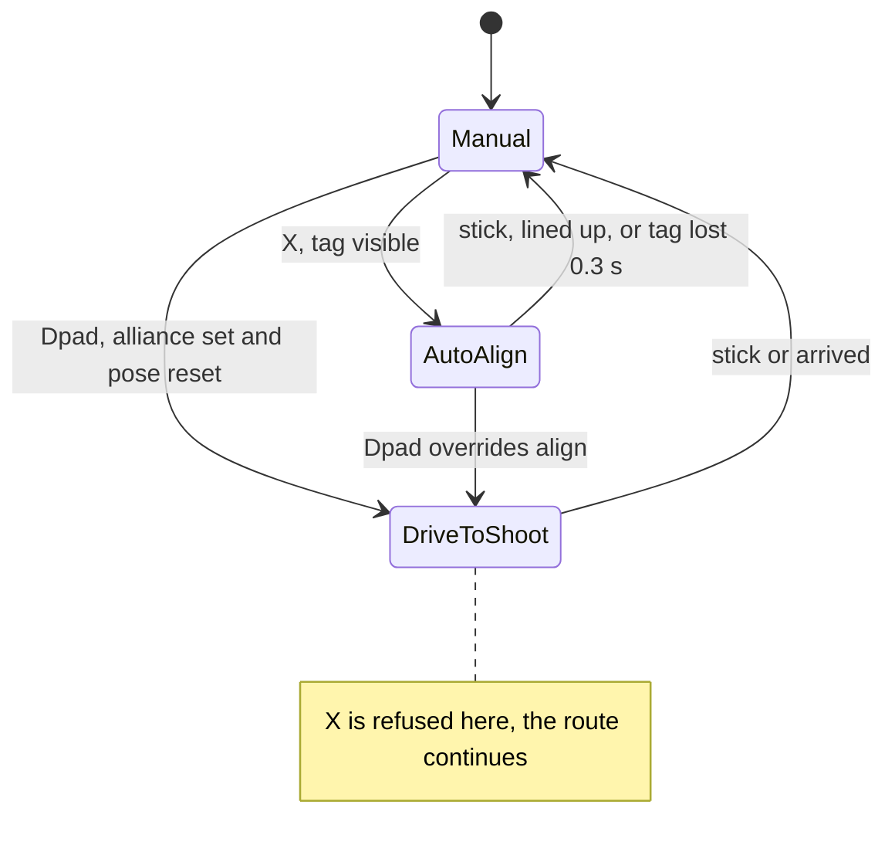

# TeleOp Driver Manual

As of 2026-11-01

## Overview

The TeleOp is a one-driver mode: everything runs from gamepad 1. Before the match, the driver picks an alliance. At the start of TeleOp, they reset the robot's position in the corner. The robot then drives in one of three modes:

- **Manual**: the driver steers with the sticks. This is the default.
- **Auto align**: the robot turns in place to face your alliance's AprilTag, using the Limelight camera.
- **Drive to shoot**: Pedro drives the robot to a shoot spot on its own, going around the HIVEs.

Moving a stick always hands control back to the driver. The intake, shooter and windmill have their own on/off buttons and work in any mode.

## Before the match (init)

Pick the alliance before pressing Start. It can't be changed once the match is running.

1. Select **TeleOp** (group TeleOp) on the Driver Station and press **Init**.
2. Pick the alliance on gamepad 1: **X = BLUE**, **B = RED**.
3. Check that the screen shows `Alliance: BLUE` or `Alliance: RED`, not `NOT SELECTED`.
4. Check the LIMELIGHT DEBUG section to confirm the camera is connected.
5. Press **Start** when the match begins.

If no alliance is picked, auto align and drive to shoot are both disabled for the whole match. Only manual driving and the mechanisms work.

## Start of TeleOp: reset the pose

Drive to shoot stays off until you reset the pose once with the left trigger. The robot assumes it starts at (9, 9), facing up the field, which is wrong after auto. Planning a route from a wrong position could drive the robot into a HIVE.

1. Drive the robot into the bottom-left corner, so its position is (9, 9), facing up the field (90°).
2. Pull the **left trigger** all the way. One short rumble confirms the reset.
3. The `!! POSE NOT RESET !!` warning disappears from the status section. Dpad up and down now work.

You only need to reset once per match. Reset again any time the position seems off, for example after a hard hit. Auto align doesn't need a reset because it only uses the camera.

## Controls (gamepad 1)

| Input | What it does | Notes |
| --- | --- | --- |
| Left stick | Drive forward/back and strafe | Moving any stick past 10% cancels auto align and drive to shoot |
| Right stick X | Turn | Scaled to 80% for finer control |
| Right stick Y | Nothing (only cancels auto modes) | |
| Right trigger (hold) | Slow mode, 20% speed | Only affects manual driving |
| Left trigger | Reset pose to (9, 9), facing up the field | Robot must be in that corner; enables drive to shoot |
| X | Auto align to your alliance's AprilTag | Needs a visible tag; refused while driving to shoot |
| Dpad up | Drive to the upper shoot spot | Needs an alliance and a pose reset |
| Dpad down | Drive to the lower shoot spot | Needs an alliance and a pose reset |
| A | Intake on/off | Runs the intake motor and both intake servos at full power |
| B | Shooter on/off | Flywheel at 1700 ticks/s |
| Dpad left | Windmill forward; press again to stop | |
| Dpad right | Windmill reverse; press again to stop | Switching from forward to reverse works directly |

During init, X and B pick the alliance instead (X = BLUE, B = RED).

## Drive modes and priority

The robot is in exactly one drive mode at a time. When inputs conflict, the higher priority wins: **sticks > left-trigger reset > dpad (drive to shoot) > X (auto align)**.

- **Moving a stick** always switches to manual, from any mode, in the same instant.
- **Dpad while aligning** stops aligning and starts the route.
- **X while driving to shoot** is refused (three blips). To align after the route, wait until it arrives, or move a stick first.
- **Buttons pressed together:** only the highest-priority one acts. The others are ignored, not saved for later.

The automatic modes also end on their own and return to manual:

| Mode | Ends when |
| --- | --- |
| Auto align | The tag is within 1° of center (stops turning), or the tag is out of view for more than 0.3 s (three blips) |
| Drive to shoot | The robot reaches the shoot spot. It stops briefly at each corner of the route so it doesn't swing wide |

## Rumble feedback

The gamepad rumbles to tell the driver whether a request worked, so they don't need to look at the screen.

| Rumble | Meaning | When |
| --- | --- | --- |
| One short rumble (0.2 s) | Accepted | Auto align started, drive to shoot started, pose reset |
| Three quick blips | Refused or gave up; nothing changed | X with no tag visible or while driving to shoot; dpad with no alliance, no pose reset, or no route around the HIVEs; auto align lost the tag for more than 0.3 s |

## Reading the telemetry

The STATUS section is the one to watch during a match. It sits below the controls list, so you may need to scroll down to it.

| Line | What it tells you |
| --- | --- |
| `!! POSE NOT RESET !!` | Drive to shoot is still off; do the left-trigger reset |
| Alliance | BLUE, RED, or NOT SELECTED (auto features disabled) |
| Drive mode | MANUAL, ALIGNING or DRIVING_TO_SHOOT |
| Target seen | Whether the Limelight sees your alliance's tag right now; X only works when true |
| Intake on / Shooter on / Windmill | Current state of each mechanism (Windmill shows OFF, FORWARD or REVERSE) |
| Shooter target / Shooter velocity | Wanted vs actual flywheel speed in ticks/s; shoot once they match |
| Slow mode | True while the right trigger is held |
| Route corners / Route | How many corners the last drive-to-shoot route had, and its waypoints |
| x, y, heading | Where the robot thinks it is, in inches and degrees |
| tx, ty | Tag angle from the camera; tx near 0 means aligned |

The PEDRO DEBUG and LIMELIGHT DEBUG sections are for programmers.

## Troubleshooting

| Problem | Likely cause | What to do |
| --- | --- | --- |
| X gives three blips | No tag visible, no alliance picked, or the robot is driving to shoot | Point the robot toward your tag and check `Target seen`; wait for the route to finish or move a stick to cancel it |
| Dpad gives three blips | No alliance, no pose reset, or no route around the HIVEs | Check `Alliance` and the pose warning; do the left-trigger reset |
| Auto align stops before it's lined up | Tag lost for more than 0.3 s | Press X again once `Target seen` is true |
| Auto align stops slightly off | It stops at the first reading within 1° | Press X again |
| Robot drives to the wrong spot | Pose has drifted or wasn't reset in the right corner | Move a stick to cancel, drive to the corner, reset with the left trigger |
| Drive to shoot keeps pushing against something | The route is blocked; there's no time limit while driving | Move a stick to take over |
| Auto mode cancels by itself | A drifting stick reads above 10% | Recalibrate or swap the controller |
| Windmill doesn't do what you expect | Same button pressed twice turns it off | Press dpad left for forward or dpad right for reverse |
| Shooter misses at long or short range | Speed is fixed at 1700 ticks/s | See the notes for programmers |

## Notes for programmers

The code lives in `TeamCode/src/main/java/org/firstinspires/ftc/teamcode/TeleOp/Teleop.java`. It uses `AutoAlign` and `LimeLightCamera` (in `Vision/`) and `HiveAvoider` (in `TeleOp/`).

**Tuning constants (top of `Teleop.java`)**

| Constant | Value | What it controls |
| --- | --- | --- |
| `SHOOTER_VELOCITY` | 1700 ticks/s | Flywheel speed |
| `STICK_DEADBAND` | 0.1 | Stick movement that cancels auto modes |
| `SLOW_TRIGGER` / `SLOW_SPEED` | 0.1 / 0.2 | Right-trigger threshold and slow-mode speed |
| `TURN_SCALE` | 0.8 | Right-stick turn scale |
| `RESET_TRIGGER` | 0.5 | Left-trigger threshold for the pose reset |
| `TAG_LOST_TIMEOUT` | 0.3 s | How long auto align waits for a lost tag |
| `FIELD_SIZE` | 144 in | Used to mirror red poses to blue |

The auto-align turn gains (`kP`, `MIN_TURN`, `MAX_TURN`, `TOLERANCE`) are in `AutoAlign.java`. The HIVE boxes and robot margin are in `HiveAvoider.java`.

**Field values still to tune (TODO)**

- [ ] Red shoot spots: up (60, 132, 90°) and down (56, 8, 270°). Blue is mirrored automatically: x → 144 − x, heading → 180° − heading.
- [ ] HIVE positions and `MARGIN` in `HiveAvoider`.
- [ ] Shooter speed: `ShooterSpeed.fromTy()` exists but isn't connected yet, and its table is still placeholders.

**Known limitations**

- The reset corner is (9, 9) for both alliances. If blue drivers reset in the opposite corner (135, 9), their routes start from the wrong place.
- The alliance can only be picked during init.
- Drive to shoot has no overall time limit; the driver must cancel a blocked route.
- The robot's position isn't passed from auto to TeleOp; the left-trigger reset covers for this.
